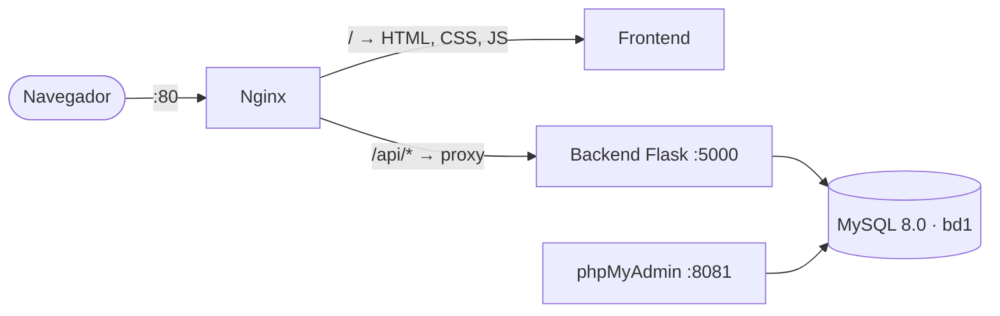
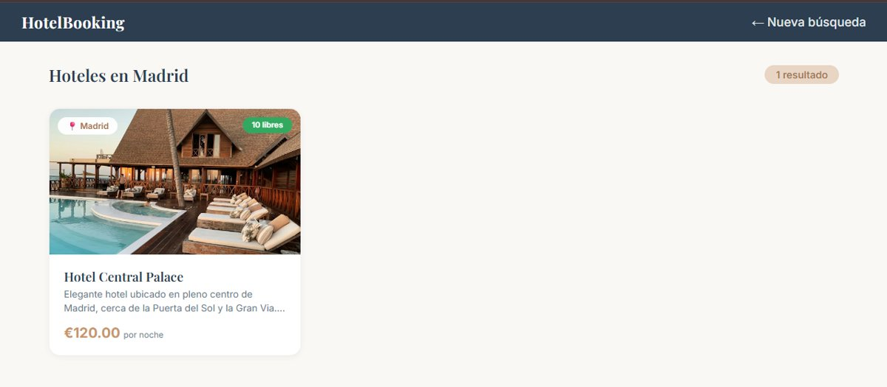
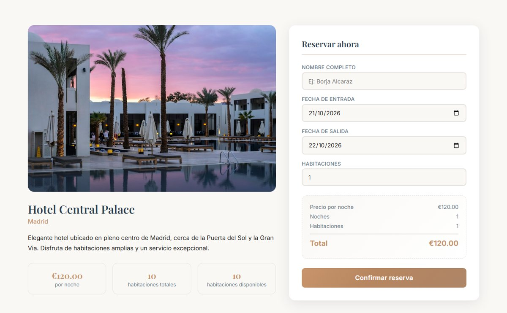
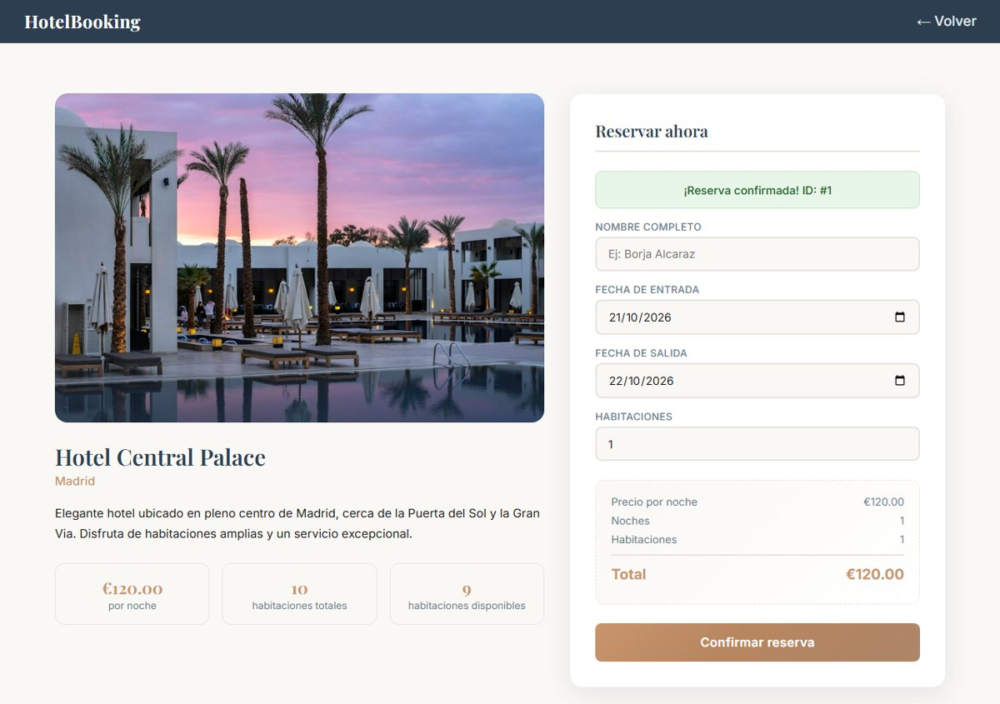
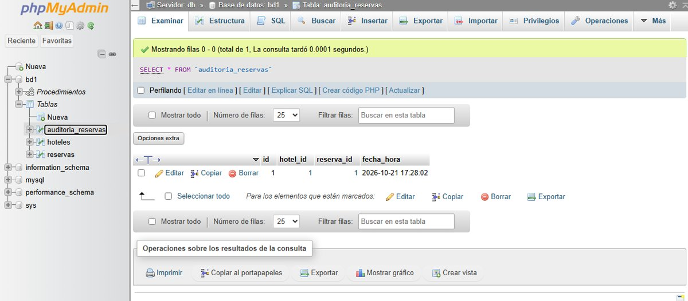

# 🏨 HotelBooking · Buscador y reservas de hoteles

Aplicación web para **buscar hoteles por ciudad y fechas, consultar su disponibilidad y hacer reservas**, conectada a una base de datos **MySQL** y desplegada con **Docker Compose**. Proyecto de la asignatura de **Bases de Datos** del Grado Superior en ASIR (Digitech FP Madrid).


---

## 📌 Sobre el proyecto

El objetivo era crear una aplicación completa en la que la web se comunique con una base de datos real a través de una API, con todos los servicios levantados en contenedores Docker.

La lógica de las reservas está en la propia base de datos: un **procedimiento almacenado** comprueba la disponibilidad y crea la reserva, y un **trigger** registra cada reserva en una tabla de auditoría.

**Desarrollo con IA:** proyecto individual desarrollado con ayuda de inteligencia artificial, usando **OpenCode** para la planificación (*planning*) y la construcción (*building*) de la web, la API y la conexión con la base de datos y los contenedores.

## ✨ Funcionalidades

- **Hoteles destacados** en la página de inicio, cargados desde la base de datos.
- **Buscador** por ciudad, fecha de entrada, fecha de salida y número de habitaciones.
- **Resultados** con solo los hoteles que tienen **habitaciones libres** en esas fechas.
- **Ficha del hotel** con descripción, imágenes, precio y habitaciones disponibles.
- **Reserva** con cálculo automático de noches y precio total.
- **Validaciones** en el navegador y en el servidor: campos obligatorios, la salida posterior a la entrada, sin fechas pasadas y número de habitaciones válido.
- **Gestión visual de la base de datos** con phpMyAdmin.

## 🏗️ Arquitectura



| Servicio | Contenedor | Puerto | Función |
|---|---|---|---|
| **Nginx** | `servidor-nginx` | 80 | Sirve el frontend y redirige `/api/` al backend (proxy inverso) |
| **Backend** | `backend-flask` | 5000 (interno) | API REST en Python con Flask |
| **MySQL** | `db-mysql` | 3306 | Base de datos `bd1` |
| **phpMyAdmin** | `pma-control` | 8081 | Administración visual de la base de datos |

Los servicios arrancan en orden gracias a los **healthchecks**: el backend espera a que MySQL esté listo y Nginx espera al backend.

## 🗄️ Base de datos

| Elemento | Tipo | Descripción |
|---|---|---|
| `hoteles` | Tabla | Nombre, ciudad, descripción, precio por noche, número de habitaciones e imágenes |
| `reservas` | Tabla | Hotel, cliente, fechas de entrada y salida y habitaciones reservadas |
| `auditoria_reservas` | Tabla | Registro de cada reserva creada, con fecha y hora |
| `tr_auditoria_reservas` | Trigger | Tras cada reserva nueva, la anota automáticamente en la auditoría |
| `sp_realizar_reserva` | Procedimiento almacenado | Comprueba la disponibilidad en esas fechas y crea la reserva solo si hay habitaciones libres |

La base de datos se crea sola la primera vez que arranca el contenedor, con **6 hoteles de ejemplo** en Madrid, Barcelona, Sevilla, Valencia, Granada y Bilbao.

## 🔌 API

| Método | Ruta | Descripción |
|---|---|---|
| `GET` | `/api/hoteles/destacados` | Hoteles destacados para la página de inicio |
| `GET` | `/api/hoteles?ciudad=&fecha_entrada=&fecha_salida=&habitaciones=` | Búsqueda de hoteles con disponibilidad |
| `GET` | `/api/hoteles/<id>` | Detalle de un hotel y sus habitaciones disponibles |
| `POST` | `/api/reservas` | Crea una reserva (llama al procedimiento almacenado) |
| `GET` | `/api/test-db` | Comprueba la conexión con la base de datos |
| `GET` | `/health` | Estado del backend (lo usa el healthcheck de Docker) |

Todas las consultas usan **parámetros**, así que la API está protegida frente a inyección SQL.

## ▶️ Cómo ejecutarlo

**Requisito:** tener instalado [Docker Desktop](https://www.docker.com/products/docker-desktop/).

1. Descarga o clona el repositorio y abre una terminal en su carpeta.
2. Levanta los contenedores:
   ```bash
   docker compose up --build -d
   ```
3. Espera unos segundos a que arranquen y abre:
   - **Web:** http://localhost
   - **phpMyAdmin:** http://localhost:8081 (usuario `root`, contraseña `root`)
4. Para pararlo: `docker compose down`. Para empezar de cero con la base de datos limpia: `docker compose down -v`.

> Las credenciales (`root` / `root`) son solo para desarrollo local. En un entorno real irían en un archivo `.env` y con un usuario sin permisos de administrador.

## 💻 Tecnologías

`Docker` · `Docker Compose` · `Nginx` · `Python` · `Flask` · `MySQL` · `SQL` · `phpMyAdmin` · `HTML5` · `CSS3` · `JavaScript` · `OpenCode (IA)`

## 🖼️ Capturas

<table>
  <tr>
    <td align="center"><br><sub>Resultados de búsqueda</sub></td>
    <td align="center"><br><sub>Ficha del hotel y reserva</sub></td>
  </tr>
  <tr>
    <td align="center"><br><sub>Reserva confirmada</sub></td>
    <td align="center"><br><sub>Auditoría: el trigger registra la reserva en phpMyAdmin</sub></td>
  </tr>
</table>

## 📁 Estructura

```
├── docker-compose.yml     Define y conecta los 4 servicios
├── backend/
│   ├── main.py            API REST en Flask
│   ├── requirements.txt   Dependencias de Python
│   └── Dockerfile         Imagen del backend (usuario sin permisos de root)
├── db/
│   ├── init.sql           Tablas, trigger, procedimiento y datos de ejemplo
│   ├── update.sql         Aplica los cambios de estructura sin borrar los datos
│   └── datos_reservas.sql Ejemplo para pasar reservas entre equipos
├── frontend/
│   ├── index.html         Inicio y buscador
│   ├── resultados.html    Resultados de la búsqueda
│   ├── detalle.html       Ficha del hotel y reserva
│   ├── css/               Estilos
│   └── js/                Lógica de cada página
├── nginx/
│   └── default.conf       Servidor web y proxy inverso
└── docs/                  Documentación del proyecto (PDF)
```

## 📄 Documentación

- [Documentación del proyecto](docs/documentacion.pdf): estructura y función de cada archivo.
- [Flujo detallado](docs/flujo-detallado.pdf): comunicación entre navegador, Nginx, backend y MySQL en cada acción.
- [Cómo pasar el proyecto entre equipos](docs/pasar-entre-dispositivos.pdf).

---

👤 **Marco Roblin Bianchi** · [Portfolio](https://mroblinb.github.io) · [LinkedIn](https://www.linkedin.com/in/marco-roblin-bianchi/) · [GitHub](https://github.com/mroblinb)
